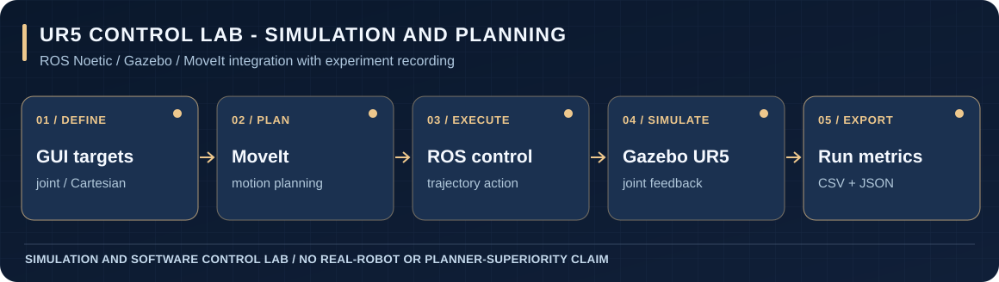

# UR5 Control Lab — ROS/Gazebo Robot Control and Motion Planning

**Robotics engineering portfolio project.** A ROS Noetic + Gazebo simulation application for controlling a UR5 manipulator through MoveIt, with a CustomTkinter interface and experiment recording.

## System overview



*Software/simulation architecture diagram; it does not depict real robot execution.*

## What this repository demonstrates

| Area | Implementation / evidence |
| --- | --- |
| ROS application integration | [ROS package](src/ur5_control_lab/), launcher scripts and Gazebo/MoveIt startup integration |
| Robot motion planning | MoveIt-based joint and Cartesian target execution; pose goals include position and roll/pitch/yaw |
| Experimental instrumentation | Run metadata and CSV/JSON export; reported measurements include runtime, joint/EE path lengths, speed statistics and final joint error |
| Reproducible environment | [Dockerfile](Dockerfile), [Docker launcher](run_docker.sh), [local launcher](run_project.sh) |
| Software regression tests | [Tests](tests/) for planner interface, pose targets, entrypoints and experiment tracking |

## Quick start

```bash
./run_docker.sh
```

A Docker-compatible host with a working graphical display setup is required for Gazebo and the GUI. For manual/local setup, follow the instructions below. Successful startup, motion execution and runtime metrics must be verified on the target machine rather than assumed from the scripts alone.

## Scope and missing validation

The current documentation describes a ROS Noetic/Gazebo/MoveIt software control lab; it does **not** establish real-UR5 deployment, sim-to-real transfer or comparative planner superiority. To turn it into a stronger internship demonstration, add a short screencast, a reproducible example trajectory and a results table comparing at least two planning scenarios using the existing recorder.

---

## Installation and developer details

# UR5 Control Lab

This project provides a comprehensive platform for simulating and controlling a UR5 robot using ROS Noetic and Gazebo.
The recommended GitHub repository name for this project is `ur5-control-lab`, while the internal ROS/Python package name remains `ur5_control_lab`.

## Architecture
The project is organized around a single Python ROS package:
- **`src/ur5_control_lab/src/ur5_control_lab/core`**: kinematics, dynamics, and planning logic.
- **`src/ur5_control_lab/src/ur5_control_lab/gui`**: the CustomTkinter GUI and reusable widgets.
- **`src/ur5_control_lab/scripts/main.py`**: the only supported GUI entrypoint.

## Quick Start (Docker)

Use the one-click script to build the image, start Gazebo, and launch the GUI:

```bash
./run_docker.sh
```

The container now uses `docker_entrypoint.sh` as its single startup path, so Docker and local usage both launch the same GUI entrypoint: `rosrun ur5_control_lab main.py`.
The default Gazebo world now starts with the camera aimed at the UR5, so the robot should be visible as soon as the simulator opens.
`./run_docker.sh` also creates `exports/experiments/` in the host workspace and mounts the repository `exports/` directory into the container, so experiment exports remain available on the host after the container exits.
The default startup flow now launches MoveIt alongside Gazebo, so the GUI can execute Cartesian position and pose targets through MoveIt as soon as the app opens.

## Local Usage

1. Install Python GUI dependencies:
   ```bash
   python3 -m pip install -r requirements.txt
   ```

2. Build the catkin workspace:
   ```bash
   catkin_make
   ```

3. Run the one-click local launcher:
   ```bash
   ./run_project.sh
   ```

This starts `roslaunch ur_gazebo ur5_bringup.launch`, waits for `/joint_states` and the trajectory action server, then launches the GUI.
The launcher now also starts MoveIt planning execution and waits for `move_group` before opening the GUI.
Gazebo uses the project default camera view, which is centered on the UR5 near the world origin.

## App-Only Mode

If Gazebo and ROS are already running in another terminal:

```bash
./run_project.sh --app-only
```

## Manual Developer Flow

If you want separate terminals during development:

1. Terminal A:
   ```bash
   roslaunch ur_gazebo ur5_bringup.launch
   ```
2. Terminal B:
   ```bash
   source devel/setup.bash
   rosrun ur5_control_lab main.py
   ```

## Notes

- The supported GUI entrypoint is `rosrun ur5_control_lab main.py`.
- `requirements.txt` is the shared source of truth for pip-installed Python dependencies.
- `build/` and `devel/` are generated artifacts. Rebuild them with `catkin_make` instead of editing them manually.
- The Path Planning tab now records named experiment runs with planner metadata and execution duration.
- The Path Planning tab now supports Cartesian pose targets with `X/Y/Z` position inputs and `Roll/Pitch/Yaw` orientation inputs through MoveIt.
- Completed runs can be exported from the Recorder tab as `json` and `csv` files under `exports/experiments/`.
- When started with `./run_docker.sh`, those export files are persisted to the host repository at `exports/experiments/`.
- The Recorder tab now shows basic experiment metrics, including runtime, joint path length, end-effector path length, speed statistics, and final joint error.
