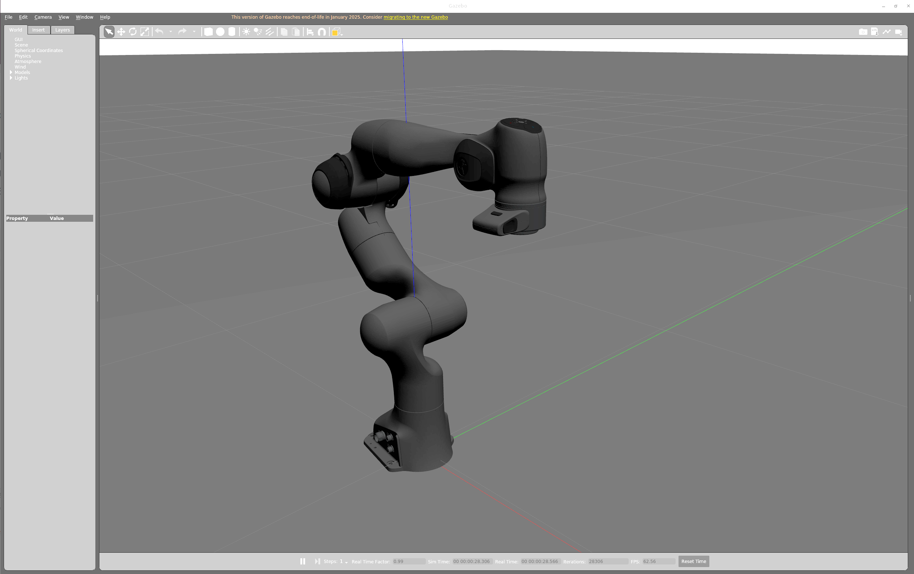
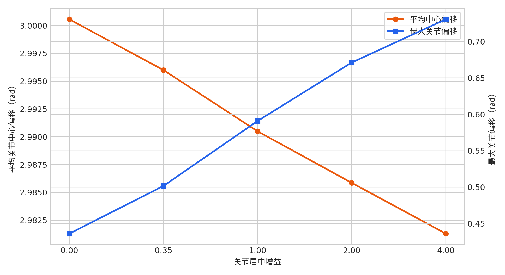

# UR5 Control Lab · 可视化展示

[English project README](README.md) · [完整图注与源数据](docs/visual-results.md)

本仓库包含ROS/Gazebo/MoveIt的UR5软件集成。以下新增素材来自独立的本地Franka/零空间开发版本；本公开分支尚未包含该扩展源码，本次只发布展示材料，不能据此声称当前公开代码已支持这些实验。

仿真场景，不是真机照片；机器人模型保留上游归属。

历史离线数值实验，左右纵轴不同；平均中心偏移下降伴随最大关节运动幅度增大，不能表述为真机精度或普遍性能提升。原始汇总数据和来源校验值见完整图注。
