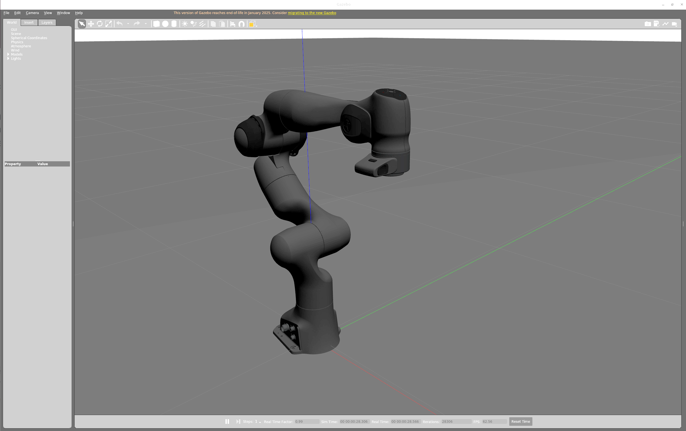
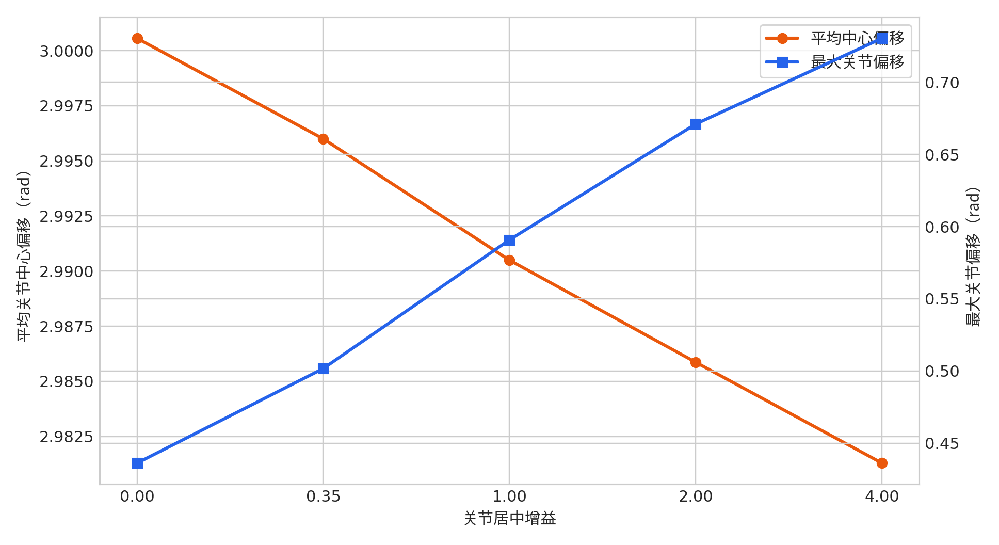

# Visual results · 可视化结果

These existing artifacts show the simulation environment and an offline redundancy-resolution experiment. They are historical outputs, not a new benchmark run. 原图完整保留，未改数据或曲线。

## Franka simulation environment

Gazebo中七轴Franka模型的仿真场景。用于展示机器人模型与仿真环境，不代表真机部署或算法性能；截图中的FPS也不是控制环频率。机器人模型与Gazebo属于上游资产/工具，项目贡献为软件与算法集成。

## Joint-centering gain sweep

历史离线零空间规划实验。增益依次为0、0.35、1、2、4；橙线为平均关节中心偏移范数（左轴，rad），蓝线为最大关节偏移（右轴，rad）。两个纵轴范围不同，不能用两条曲线的交点或斜率直接比较物理量。

在该记录的构型下，增大增益使平均关节中心偏移减小，同时最大关节运动幅度增大。这说明该参数的取舍，不构成所有初始构型下的泛化结论。表中的末端漂移是离线计算值，不是真机跟踪精度；这5个参数设置也不是5组独立重复实验。

[Source data / 原始汇总CSV](media/joint-centering-sweep.csv)。生成逻辑为 `scripts/generate_thesis_figures.py::figure_6_10a_centering_gain_sweep`；离线实验逻辑在 `scripts/run_offline_experiment_extensions.py`。本轮核对了表格、绘图字段及图片，未重新运行实验。

这些图片来自独立的本地Franka/零空间开发版本；当前公开分支尚未包含该扩展实现，因此不能仅凭本分支复现这些实验。相关源码仍在本地，本次仅发布展示材料。[素材来源与校验值](media/manifest.json)记录原始位置和原样复制的SHA-256。
